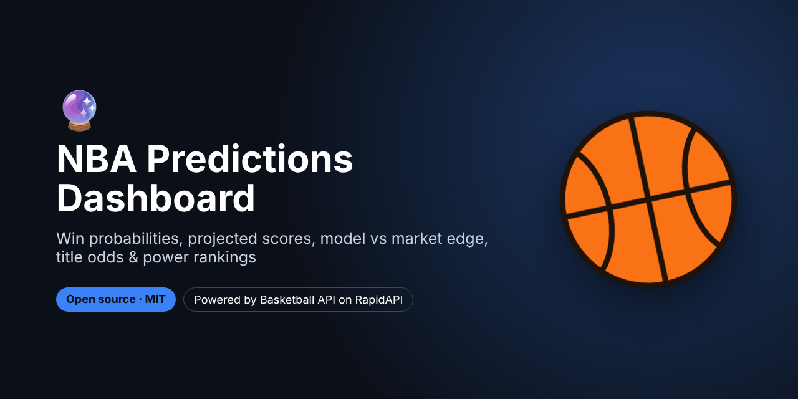
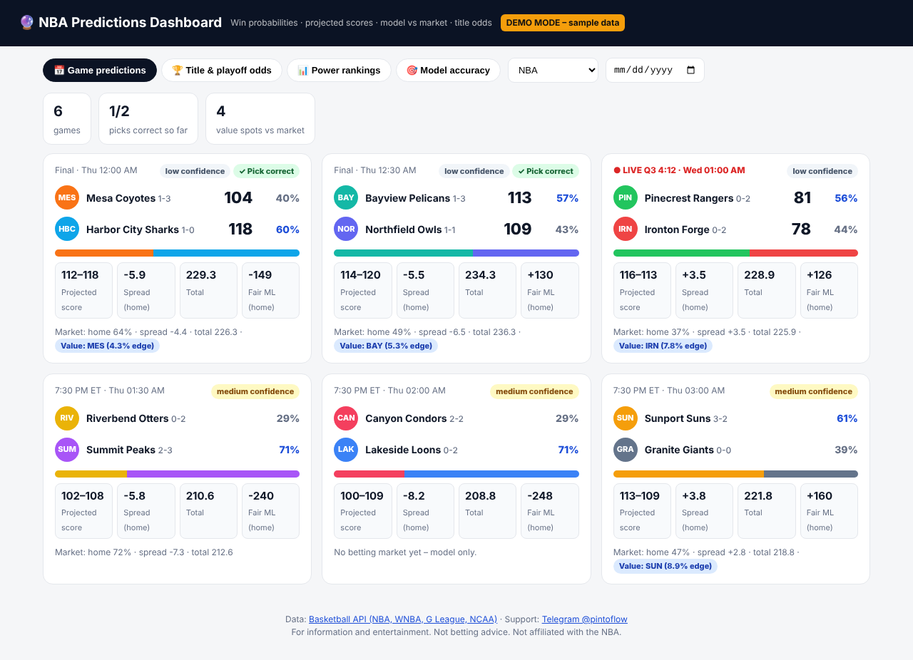
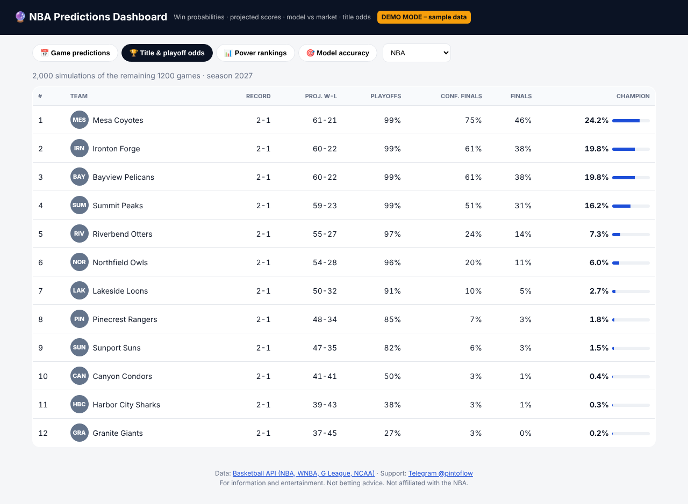
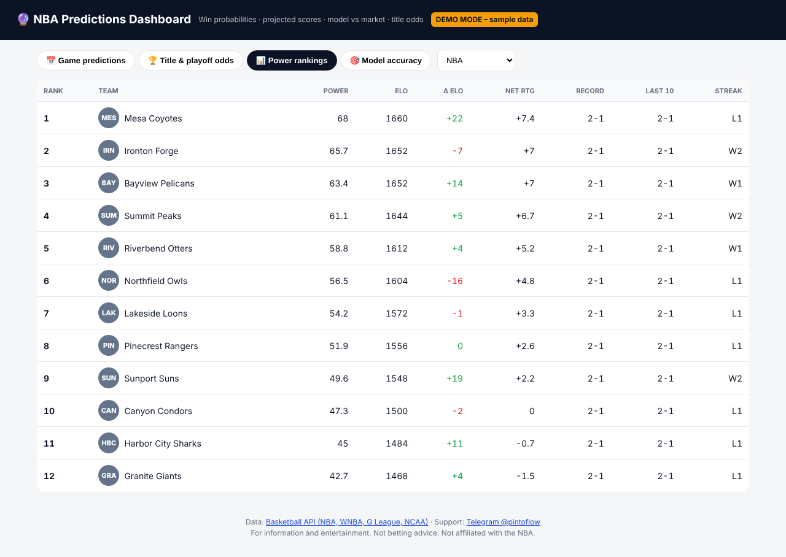

# NBA Predictions Dashboard – Win Probabilities, Projected Scores & Title Odds



> **For faster support reply, contact us on Telegram: [@pintoflow](https://t.me/pintoflow)**

A self-hosted **NBA predictions website** for every game of the day:

- 🎯 **Win probability** for both teams, the **projected score**, **spread** and **total**
- 💹 **Model vs betting market**: the market's implied probability, plus a **value tag** when the model and the market disagree by 4% or more
- ✅ For finished games, whether the **pick was right**, and the day's record
- 🏆 **Title and playoff odds** from a Monte Carlo season simulation
- 📊 **Power rankings** (Elo, net rating, streaks) and the model's **accuracy track record**

It covers the **NBA, WNBA, G League and NCAA men's and women's basketball**. It's Node.js with **zero dependencies**.

Powered by the **[Basketball API (NBA, WNBA, G League, NCAA)](https://rapidapi.com/belchiorarkad-FqvHs2EDOtP/api/api-basketball-nba)** on RapidAPI.







<sub>Screenshots in demo mode with fictional teams and sample numbers.</sub>

---

## Why this exists

"NBA predictions today", "NBA picks" and "NBA championship odds" are searched millions of times every season. Sports sites, newsletters and Discord communities publish model picks daily. This dashboard gives you a ready-made, brandable predictions page you can host yourself.

## Ideas

- A **sports blog or newsletter** with a daily "model picks" page
- A **predictions widget** for your Discord or fan site
- A **paid picks product** built on top of the model and the market edge
- **College basketball** pages with `league=ncaam` and `league=ncaaw`

## Quick start

```bash
git clone https://github.com/BelNaruto/nba-predictions-dashboard.git
cd nba-predictions-dashboard

node server.js                                 # demo mode
RAPIDAPI_KEY=your_rapidapi_key node server.js  # live data
```

Open **http://localhost:3001**. Requires Node.js 18 or newer, and there's nothing to install.

Get a key: **https://rapidapi.com/belchiorarkad-FqvHs2EDOtP/api/api-basketball-nba**

## API endpoints used

| Endpoint | Used for |
|---|---|
| `GET /v2/predictions?date=YYYYMMDD` | Every game of the day with the prediction object (and `meta.record` for finished games) |
| `GET /v2/predictions/season` | Season and playoff simulation: playoffs, conference finals, finals and title odds |
| `GET /v2/power-rankings` | Rank, power score, Elo and its change, net rating, record, streak |
| `GET /v2/predictions/accuracy` | The model's accuracy, Brier score and log loss vs a baseline |

The **prediction object** includes `winProbability`, `modelWinProbability`, `fairMoneyLine`, `projectedScore`, `projectedSpread`, `projectedTotal`, `confidence` and a `market` block with `edge.valueSide`. See the [API docs](https://rapidapi.com/belchiorarkad-FqvHs2EDOtP/api/api-basketball-nba).

## Deploy

Deploy to **Google Cloud Run, Render, Railway, Fly.io** or any VPS with the start command `node server.js` and the env var `RAPIDAPI_KEY`. The server caches each response for the API's `meta.cacheTtlSeconds`.

## Related projects

- 📊 [NBA Player Props Analyzer](https://github.com/BelNaruto/nba-player-props-analyzer): hit rates, trends and prop projections
- 🔔 [NBA Live Scores Bot](https://github.com/BelNaruto/nba-live-scores-bot): Discord and Telegram previews, live scores and finals
- 📘 [Basketball API docs and examples](https://github.com/BelNaruto/basketball-api-nba)

## Support

> **For faster support reply, contact us on Telegram: [@pintoflow](https://t.me/pintoflow)**

API: https://rapidapi.com/belchiorarkad-FqvHs2EDOtP/api/api-basketball-nba

---

MIT License. For information and entertainment; this is not betting advice. Not affiliated with the NBA or any sportsbook.

**Keywords:** nba predictions today, nba picks, nba win probability, nba projected scores, nba championship odds, nba playoff odds, nba power rankings, basketball predictions, ncaa basketball predictions, wnba predictions, basketball api
